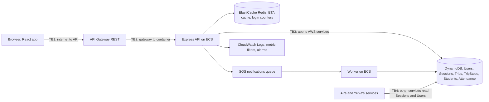

# Threat model: Schedule & Arrival service (plus signup and login)

Owner: Ahmed Elfouly (230102), Team 14. Method: STRIDE.

## What the service does

- Signup and login for the whole app. Passwords are stored as bcrypt hashes. A login gives a random token, and only its SHA-256 hash is saved in the `Sessions` table. Ali's and Yehia's services read this table to check tokens.
- Trip ETA: the planned arrival window at each stop, cached in Redis (ElastiCache).
- Attendance: a supervisor marks a student as boarded or dropped on his own bus. A parent sees only his own children.
- A worker reads the notification queue (SQS) and writes parent alerts.

Runs on Floci: API Gateway (REST) forwards to the Express API on ECS. Data is in DynamoDB. Logs go to CloudWatch.

## Data flow and trust boundaries

## STRIDE table

| ID | STRIDE | What can go wrong | Asset | Likelihood / Impact | Control in the code | Test that proves it | Risk left |
|---|---|---|---|---|---|---|---|
| T1 | Spoofing | Someone guesses a parent's password by trying many passwords (brute force). | User accounts | High / High | `services/login-limiter.service.js`, used in `controllers/sessions.controller.js`: after 3 wrong passwords for one email in 10 minutes, login gives 429 with `Retry-After` for 10 minutes. Counts are in Redis, so all ECS copies share them. | ST-09. Jest: "3 wrong passwords, then the 4th try is blocked with 429 and Retry-After, even with the right password" | The per-IP limit is off, because behind API Gateway all requests come from the gateway address. An attacker can still try 3 passwords per email every 10 minutes. |
| T2 | Information disclosure | The login answer tells an attacker which emails have accounts. | User emails | Medium / Medium | `controllers/sessions.controller.js` gives the same 401 "Email or password is incorrect" for a wrong email and a wrong password. | ST-04. Jest: "a wrong email and a wrong password give the same 401 answer" | Response time can differ a little, because bcrypt only runs for a real user. |
| T3 | Spoofing | A stolen, made-up or old token is used to act as a user. | Sessions | Medium / High | `middleware/require-auth.js`: only the SHA-256 hash of the token is stored. Each request looks it up and checks `expires_at` (8 hours). An expired session is deleted. Logout deletes the session. | ST-01, ST-02, ST-03. Jest: "login validates the password and protects API routes with the issued bearer token" | A token stolen from the browser works until it expires or the user logs out. |
| T4 | Elevation of privilege | A user signs up as admin or supervisor by adding `"role":"admin"` to the request. | Roles | Medium / High | `controllers/users.controller.js`: the signup schema is `.strict()`, so an unknown field like `role` gives 400. Signup always makes a parent. | ST-05. Jest: "signup writes a bcrypt parent profile to DynamoDB and immediately returns a session" | Admin and supervisor accounts are made by the seed script, so whoever runs it must keep its `.env` safe. |
| T5 | Information disclosure | A parent changes the trip or attendance id in the URL to see another family's child. | Attendance records | High / High | `controllers/attendance.controller.js` and `services/ownership.service.js`: a parent only gets records of his own children. Other records are hidden as 404. | ST-06. Jest: "parent only sees own child attendance and other child records are hidden as 404" | None known. |
| T6 | Tampering | A supervisor marks or changes attendance on a bus that is not his. | Attendance records | Medium / Medium | `services/ownership.service.js` (`requireStudentOnBus` and the bus supervisor check): wrong bus gives 403. | ST-07. Jest: "rejects attendance on another supervisor bus and invalid status" and "supervisor can correct own-bus attendance but cannot correct another bus record" | None known. |
| T7 | Tampering | Injection or bad input (`{"$ne": null}`, `' OR 1=1`, long strings, bad dates) breaks a query or saves bad data. | All tables | Medium / Medium | zod schemas in every controller (for example `loginSchema`, `registrationSchema`). DynamoDB is only called with typed keys, never with strings joined into a query. | ST-08. Jest: "trip cancellation date must be a real ISO calendar date" | New endpoints must keep using schemas. |
| T8 | Tampering / Repudiation | A fake or repeated message in the notification queue creates wrong alerts. | Parent alerts | Low / Medium | `worker.js` and `services/notification.service.js`: the worker only handles known event types and deletes a message only after it is processed. Only the app's IAM role can send to the queue (`scripts/provision/iam.js`). | Jest: "SQS worker writes one alert per parent and deletes only a processed message" | A message that fails many times stays in the queue. There is no DLQ yet. |
| T9 | Repudiation | Attacks happen and nobody notices. | The whole service | Medium / High | `middleware/error-handler.js` logs every 401, 403 and 429 as a `SECURITY` line (no token, no password). `scripts/provision/cloudwatch.js` adds a metric filter on `SECURITY` with an alarm (5 in 5 minutes), plus a 5xx filter and alarm. The audit service also stores login events. | ST-12. Jest: "blocked and refused logins are logged as SECURITY lines without the password" and "CloudWatch provisioning creates the SECURITY and 5xx metric filters and their alarms" | The alarms have no action yet (no SNS email), so someone must look at CloudWatch. |
| T10 | Information disclosure | Keys or passwords leak through git, the container settings or the logs. | Secrets | Medium / High | `.env` is ignored by git. `.env.example` has placeholders only. Seed passwords are empty there. Floci uses dummy keys `test`/`test`. Logs never contain the Authorization header or the password. | ST-11. Jest: "request and response logs are structured and redact authorization headers" | On real AWS the seed passwords should move to Secrets Manager. |
| T11 | Tampering | Wrong data in the Redis cache shows parents wrong arrival times. | ETA answers | Low / Medium | `services/cache.service.js`: only the server writes the cache, from DynamoDB. Writing new trip times or changing a trip's status deletes the cached ETA. Redis is only reachable inside the Floci network. | Jest: "ETA returns ordered arrival windows and serves cache HIT until times are replaced" and "admin status change invalidates ETA and creates a cancellation notification event" | Redis has no password on Floci. |

## Out of scope and limits

- Everything runs on Floci on one laptop with test data, not on real AWS.
- Floci does not enforce API Gateway throttling, so the login limit is done in the app.
- Live GPS tracking is not part of the project. ETA comes from planned times.
